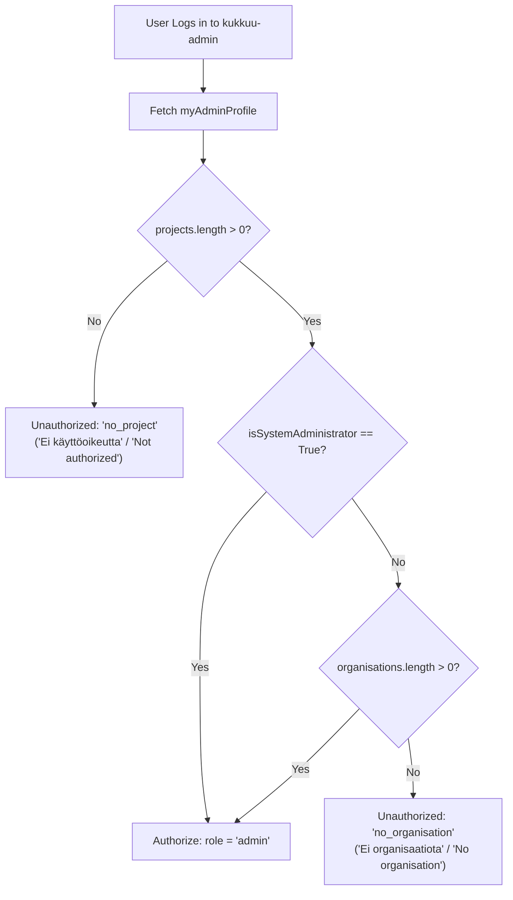

<!-- START doctoc generated TOC please keep comment here to allow auto update -->
<!-- DON'T EDIT THIS SECTION, INSTEAD RE-RUN doctoc TO UPDATE -->
**Table of Contents**  *generated with [DocToc](https://github.com/thlorenz/doctoc)*

- [Kukkuu Admin UI Privileges & Permissions](#kukkuu-admin-ui-privileges--permissions)
  - [Overview & Architecture](#overview--architecture)
  - [Preparation & Setup in Django Admin](#preparation--setup-in-django-admin)
    - [1. User Account](#1-user-account)
    - [2. User Groups and Project Object Permissions](#2-user-groups-and-project-object-permissions)
    - [3. Assigning Organisations](#3-assigning-organisations)
  - [Use Cases Matrix](#use-cases-matrix)
    - [Case 1: No staff, no organisation, some groups](#case-1-no-staff-no-organisation-some-groups)
    - [Case 2: Staff, some organisations, no groups](#case-2-staff-some-organisations-no-groups)
    - [Case 3: No staff, system organisation only, some groups](#case-3-no-staff-system-organisation-only-some-groups)
    - [Case 4: No staff, some organisations, some groups](#case-4-no-staff-some-organisations-some-groups)
    - [Case 5: Staff, any organisation, some groups](#case-5-staff-any-organisation-some-groups)
    - [Case 6: Staff, global base admin permission, any/no organisations, any/no groups](#case-6-staff-global-base-admin-permission-anyno-organisations-anyno-groups)
  - [Event and Enrolment Visibility Rules](#event-and-enrolment-visibility-rules)
    - [Event Visibility (`EventQueryset.user_can_view`)](#event-visibility-eventquerysetuser_can_view)
    - [Event Administration (`Event.can_user_administer`)](#event-administration-eventcan_user_administer)
    - [Enrolment and Attendee Data Visibility (`EnrolmentQueryset.user_can_view`)](#enrolment-and-attendee-data-visibility-enrolmentquerysetuser_can_view)
  - [Authorization Flowchart](#authorization-flowchart)

<!-- END doctoc generated TOC please keep comment here to allow auto update -->

# Kukkuu Admin UI Privileges & Permissions

This document describes how user permissions, project assignments, and organisations determine access to the administrative dashboard (`kukkuu-admin`) and access to events, occurrences, and enrolments.

## Overview & Architecture

Kukkuu employs a multi-tiered authorization model combining standard Django authentication flags, `django-guardian` row-level object permissions, Many-to-Many organisation scoping, and frontend authorization guards:

| Concept | Source of Truth | Description |
| :--- | :--- | :--- |
| **System Administrator** | `User.is_system_administrator` (`users/models.py`) | Returns `True` if `is_staff` or `is_superuser`. Staff access is intended for developers and product owners. |
| **Administered Projects** | `User.administered_projects` (`users/models.py`) | Projects where the user has the `projects.admin` permission. Evaluated via `django-guardian`'s `get_objects_for_user(user, "admin", Project)`: checks permissions assigned directly or inherited through Django **Groups**. A global `projects.admin` model permission or `is_superuser` returns all projects. |
| **Event Organiser** | `User.is_event_organiser` (`users/models.py`) | Returns `True` if the user is a system administrator, OR if they have at least one administered project **and** belong to at least one organisation. |
| **User Profile Organisations** | `myAdminProfile.organisations` (`users/schema.py`) | Returns organisations assigned to the user via the `organisations` M2M field. For system administrators, the root `organisations` query returns all organisations in the database. |
| **Admin UI Authorization Gate** | `resolveAuthorization` (`kukkuu-admin/.../authorizationUtils.ts`) | Evaluates profile payload: if no projects, returns `no_project` ("Ei käyttöoikeutta" / "Not authorized"); if non-sysadmin and no organisations, returns `no_organisation` ("Ei organisaatiota" / "No organisation"); otherwise grants `admin` role. |
| **Event Visibility** | `EventQueryset.user_can_view` (`events/models.py`) | Published events are visible across all organisations and projects. Unpublished events are visible only within administered projects and require organisation membership (unless system administrator). |
| **Event Administration** | `Event.can_user_administer` (`events/models.py`) | Editing or deleting an event requires project administration rights **and** (system administrator status OR membership in the event's organisation). |
| **Enrolment Visibility** | `EnrolmentQueryset.user_can_view` (`events/models.py`) | Enrolment and attendee records are **never** globally visible regardless of published status. Strictly restricted to administered projects and (system administrator OR event organisation membership). |

---

## Preparation & Setup in Django Admin

When configuring user accounts in Django Admin (`/admin/`):

### 1. User Account
- Navigate to **Users** (`/admin/users/user/`).
- For standard event organisers: **do not** check `Staff status` (`is_staff`) or `Superuser status` (`is_superuser`). Ensure no global permissions are assigned in the user's "User permissions" box.
- For staff / system administrators: check `Staff status`.

### 2. User Groups and Project Object Permissions
- Standard users receive project access via Django Groups:
  1. Create or select a group in **Groups** (`/admin/auth/group/`) (e.g. `Project 2030 Organisers`).
  2. Navigate to **Projects** (`/admin/projects/project/`) and open the target project.
  3. Click **Object permissions** (top right button provided by `django-guardian`).
  4. In the **Group permissions** section, enter the group name and click **Manage group permissions**.
  5. Grant the **Base admin permission** (`admin`). Grant additional permissions as needed (`publish`, `manage_event_groups`, `can_send_to_all_in_project`, `view_families`).
  6. Add the user to the group under the user's admin page.

### 3. Assigning Organisations
- Under the user's admin page in Django Admin, assign one or more organisations in the **Organisations** field.
- Without an assigned organisation, a non-staff user cannot log into the Admin UI.

---

## Use Cases Matrix

| # | Staff (`is_staff`) | Organisations | Groups (with project `admin`) | `isSystemAdmin` | `isEventOrganiser` | `myAdminProfile.projects` | Admin UI Result | Unpublished Events Visible | Event Admin (Edit/Delete) |
| :-: | :-: | :-: | :-: | :-: | :-: | :-: | :-: | :-: | :-: |
| **1** | No | None | Yes | `False` | `False` | Group projects | **Error: Not representing any organisation** (`no_organisation`) | None (cannot log in) | None |
| **2** | Yes | Some | None | `True` | `True` | Empty `[]` | **Error: No privileges** (`no_project`) | None (cannot log in) | None |
| **3** | No | Only system org | Yes | `False` | `True` | Group projects | **Success (`role: admin`)** | Own-org (system org) in group projects | Own-org (system org) in group projects |
| **4** | No | Some orgs | Yes | `False` | `True` | Group projects | **Success (`role: admin`)** | Own orgs in group projects | Own orgs in group projects |
| **5** | Yes | Any org | Yes | `True` | `True` | Group projects | **Success (`role: admin`)** | All orgs in group projects | All orgs in group projects |
| **6** | Yes | Any / None | None (global `projects.admin`) | `True` | `True` | ALL projects | **Success (`role: admin`)** | All orgs in all projects | All orgs in all projects |

> [!NOTE]
> Published events in any project are visible to all authenticated users via GraphQL query (see [Event Visibility](#event-and-enrolment-visibility-rules) below).

### Case 1: No staff, no organisation, some groups
- **Login Result**: Error on login: "Not representing any organisation" (`no_organisation`).
- **Explanation**: User has projects through their group, but `organisations` is empty and user is not system administrator. Admin UI authorization rejects the session.

### Case 2: Staff, some organisations, no groups
- **Login Result**: Error on login: "No privileges" (`no_project`).
- **Explanation**: Being `is_staff` does **not** grant project permissions by default. Without groups or direct/global object permissions on projects, `administered_projects` is empty. The Admin UI rejects users with 0 projects.

### Case 3: No staff, system organisation only, some groups
- **Login Result**: Successfully logs in (`role: admin`).
- **Capabilities**:
  - Administrates projects assigned to user's groups.
  - Sees all published events of any organisation in the project.
  - Sees unpublished events belonging to the system organisation within the group's projects.
  - Represents only the system organisation.
- **Important Note on System Organisation**: In Kukkuu, the `is_system` flag on an `Organisation` model designates the default municipal entity, but **does not grant system administrator privileges** to its members. Members of the system organisation follow the exact same scoping rules as members of any other organisation.

### Case 4: No staff, some organisations, some groups
- **Login Result**: Successfully logs in (`role: admin`).
- **Capabilities**:
  - Administrates projects assigned to user's groups.
  - Sees all published events of any organisation in the project.
  - Sees unpublished events belonging to their assigned organisations within the group's projects.
  - Can create and administer events representing their assigned organisations.

### Case 5: Staff, any organisation, some groups
- **Login Result**: Successfully logs in (`role: admin`).
- **Capabilities**:
  - Administrates projects assigned to user's groups.
  - Sees **all events** (published and unpublished) across **all organisations** within their administered projects.
  - Can edit and delete events of any organisation within their administered projects.
  - Can represent every organisation: system administrators can select any organisation in the system when creating events (the root `organisations` query returns all organisations for system administrators).

### Case 6: Staff, global base admin permission, any/no organisations, any/no groups
- **Login Result**: Successfully logs in (`role: admin`).
- **Capabilities**:
  - Administrates **all projects** in the database.
  - Sees all events (published and unpublished) across all projects.
  - Can edit, delete, and manage all events.
  - Can represent every organisation.
- **Superuser Note**: A Django `superuser` (`is_superuser=True`) automatically behaves like Case 6 without needing the explicit global `projects.admin` permission, because `django-guardian` grants all permissions to superusers by default.
- **Anti-pattern Warning**: Assigning global permissions to regular users or using global admin permissions for everyday event management is not recommended. Project-scoped group permissions should always be preferred.

---

## Event and Enrolment Visibility Rules

### Event Visibility (`EventQueryset.user_can_view`)
The backend filtering for `events` is defined as:
```python
published_q = Q(published_at__isnull=False)
admin_q = Q(project__in=user.administered_projects)
if not user.is_system_administrator:
    admin_q &= Q(organisation__in=user.organisations.all())

return self.filter(admin_q | published_q).distinct()
```
- **Published Events**: Visible to **all** users across all organisations.
- **Unpublished Events**: Restricted to administered projects. Non-system administrators must also belong to the event's organisation.
- **Project Boundary**: System administrators can view unpublished events from any organisation, but **only in projects they administer** (unless they have global project admin rights / superuser as in Case 6).

### Event Administration (`Event.can_user_administer`)
Seeing an event does not necessarily mean the user can modify it:
```python
if not user.can_administer_project(self.project):
    return False
if user.is_system_administrator:
    return True
return user.organisations.filter(id=self.organisation_id).exists()
```
Even if an event organiser can view published events belonging to other organisations in their project, they **cannot** edit, update, or delete them.

### Enrolment and Attendee Data Visibility (`EnrolmentQueryset.user_can_view`)
Unlike events, enrolment and attendee data have no public visibility branch:
```python
guardian_q = Q(child__guardians__user=user)
admin_q = Q(child__project__in=user.administered_projects)
if not user.is_system_administrator:
    admin_q &= Q(occurrence__event__organisation__in=user.organisations.all())

return self.filter(guardian_q | admin_q).distinct()
```
Attendee lists are never visible to members of other organisations, regardless of whether the event is published.

---

## Authorization Flowchart


